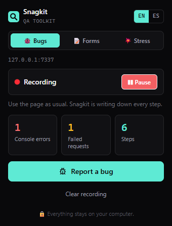
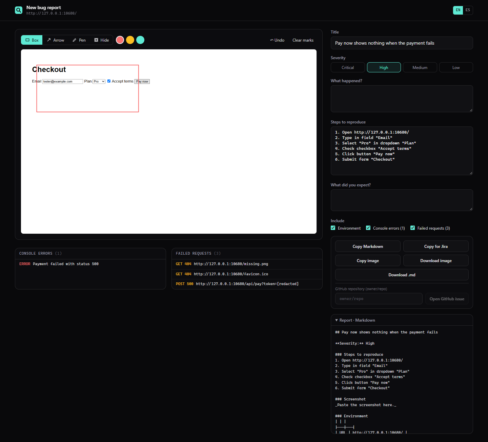
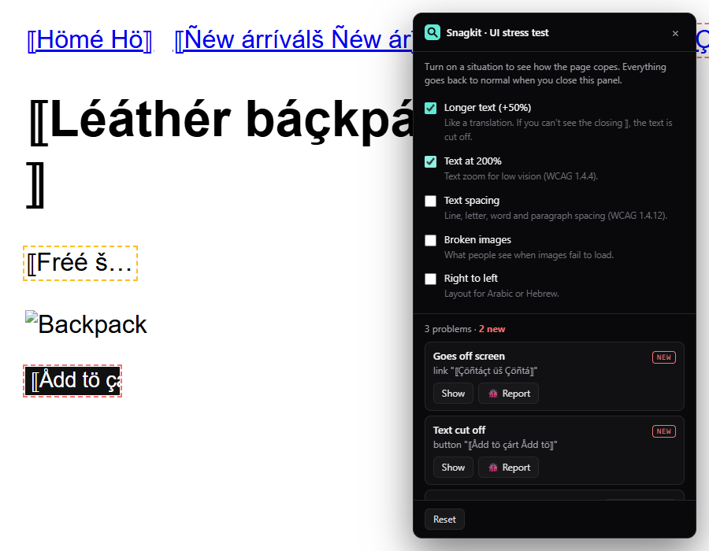

# Snagkit

**A QA toolkit that lives in your browser.** Catch a bug, click once, and get a complete report: annotated screenshot, steps to reproduce, console errors, failed requests and environment details — ready to paste into GitHub, Jira, Linear or Slack.

Everything runs locally. Snagkit has no server, no account and makes no network requests of its own.

<p align="center">
  
</p>



## Why

Writing a good bug report takes time: reproduce it, take a screenshot, open DevTools, copy the errors, note the browser and screen size, and write down every step you took. Snagkit records all of that in the background while you test, so the report is ready the moment you find the bug.

## Features

### 🐞 Bug reports (available)

- **Steps to reproduce, written for you.** Clicks, typing, dropdowns, checkboxes, form submissions and page changes become readable steps like `Click button "Pay now"` — including in single-page apps.
- **Console errors and failed requests** (HTTP 4xx/5xx and network errors) from the current tab.
- **Annotated screenshot**: boxes, arrows, freehand pen and a *Hide* tool that pixelates sensitive areas permanently.
- **Environment**: browser, OS, viewport, screen, pixel ratio, language and time.
- **Export** as Markdown, Jira markup, PNG or `.md`, or open a pre-filled GitHub issue.
- **English and Spanish** interface and reports.

### 📝 Form tester (available)

Finds every form on the page and checks it **without ever submitting it**:

| Check | Severity |
|---|---|
| Field has no label (no `<label>`, `aria-label` or `aria-labelledby`) | Error |
| Placeholder used as the only label | Warning |
| Email, phone, URL or number field declared as `type="text"` | Warning |
| Personal data field without `autocomplete` (WCAG 1.3.5) | Warning |
| Field accepts an invalid value (`test@` as email, `abcdef` as phone…) without any error | Error |
| Button with no accessible name | Error |
| Form without a submit button | Warning |
| `<label for>` pointing to a field that doesn't exist | Error |
| Duplicate field ids | Error |
| Password field on a page or form without HTTPS | Error |

To test validation, Snagkit types an invalid value, waits for the page to react (native validation, `aria-invalid`, an error class or a new error message) and then **puts the original value back**. Results appear in a panel on the page with every problem outlined; **Report** turns any of them into a bug report with the field boxed in the screenshot and the steps already written.

### 💥 UI stress test (available)

Breaks the page on purpose, the way real life does, and shows what gives way. Switch situations on one at a time from a panel on the page:

| Situation | What it simulates |
|---|---|
| **Longer text (+50%)** | A translation. Text gets accents and `⟦ ⟧` markers: if the closing `⟧` isn't visible, the text is cut off. |
| **Text at 200%** | Text zoom for low vision ([WCAG 1.4.4](https://www.w3.org/WAI/WCAG22/Understanding/resize-text)). |
| **Text spacing** | The spacing users may set ([WCAG 1.4.12](https://www.w3.org/WAI/WCAG22/Understanding/text-spacing)). |
| **Broken images** | Images that fail to load. |
| **Right to left** | Arabic or Hebrew layout. |

After each change Snagkit finds **text cut off by its box**, **text hidden behind “…”** and **elements that go off screen**, and tells apart what was **already broken** from what **the test broke**. Any problem can become a bug report with the element boxed and the steps written. Closing the panel puts the page back exactly as it was.



## Privacy by design

- **Typed text is never recorded.** Steps say *"Type in field Email"*, never what was typed. Passwords included.
- **Secrets in URLs are redacted** automatically (`token`, `apiKey`, `session`, `code`… → `[redacted]`), as are credentials embedded in URLs.
- **Records only when you say so.** Paused by default; while paused no script runs on any page.
- **Nothing leaves your computer.** Data is kept per tab in the browser's session storage and deleted when the tab closes. Only the 20 most recent report drafts are kept.

## Install

Snagkit is not on the Chrome Web Store yet. To try it:

```bash
git clone https://github.com/nuvia-ortiz/snagkit.git
cd snagkit
npm install
npm run build
```

Then open `chrome://extensions`, turn on **Developer mode**, click **Load unpacked** and select the **`dist`** folder inside the project (not the project folder itself). Works in Chrome, Edge, Brave and other Chromium browsers.

## Usage

The popup has one tab per tool — **Bugs**, **Forms** and **Stress** — so you only run the one you need. Only one panel is open on a page at a time: opening one closes the other and undoes its changes.

**Bugs**

1. Click the Snagkit icon and press **Start recording**. The icon shows a red **REC** badge.
2. Use the page as usual until you find the bug.
3. Press **Report a bug**, annotate the screenshot, add a title and export.

Snagkit is **paused by default**: while paused it injects nothing into pages and stores nothing. Once started, it stays on — across tabs and browser restarts — until you press **Pause**. Starting it also begins recording tabs that are already open, no reload needed.

## How it works

```
 page (MAIN world)          content script            service worker              extension pages
┌──────────────────┐  post  ┌──────────────┐  send   ┌───────────────────┐  open   ┌─────────────┐
│ page-hooks.ts    │──────▶│ recorder.ts  │───────▶│ background.ts     │───────▶│ report page │
│ console, errors, │ message│ clicks, input│ message │ per-tab sessions  │         │ annotate &  │
│ SPA navigation   │        │ change, keys │         │ + webRequest (4xx,│         │ export      │
└──────────────────┘        └──────────────┘         │   5xx, failures)  │         └─────────────┘
                                                      └───────────────────┘
```

- **`src/content/page-hooks.ts`** runs inside the page to see its console errors, uncaught exceptions and `history.pushState` navigation.
- **`src/content/recorder.ts`** listens for user actions and describes each element the way a person would read it (`src/shared/describe.ts`).
- **`src/background.ts`** stores a capped session per tab, watches failed requests with `chrome.webRequest`, and captures the screenshot.
- **`src/report/`** is a React app with a canvas annotator and the exporters (`src/shared/report.ts`).

## Tech stack

TypeScript · React 19 · Tailwind CSS 4 · Vite · esbuild · Chrome Extensions Manifest V3 · Vitest · Playwright

## Development

```bash
npm run build      # build the extension into dist/
npm run typecheck  # TypeScript checks
npm test           # unit tests (Vitest + jsdom)
npm run test:e2e   # end-to-end test: loads the extension in Chromium and files a real report
```

The end-to-end test opens a sample checkout page, fills in the form, triggers a console error and a failing request, creates a report through the popup and checks that the steps, errors and redactions are correct.

## Roadmap

- [x] Bug reports with steps, console, network, environment and annotated screenshot
- [x] Start / pause recording
- [x] Form tester
- [x] UI stress test
- [ ] Short screen recording of the last seconds before the bug
- [ ] Chrome Web Store release

## License

[MIT](LICENSE) © Nuvia Ortiz Basulto
